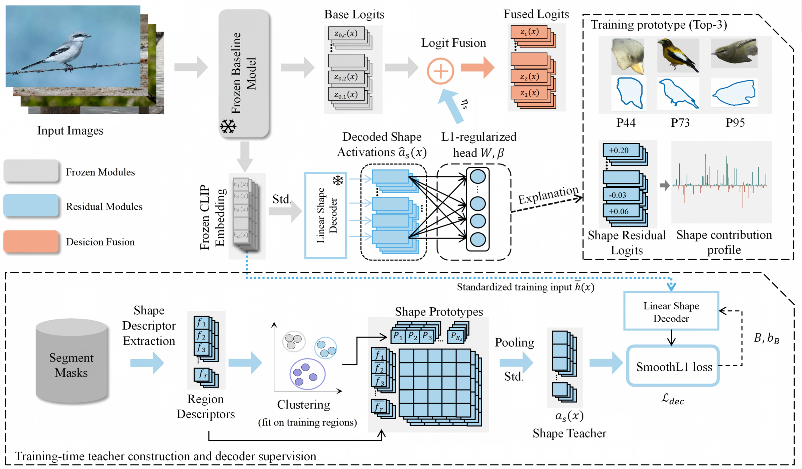
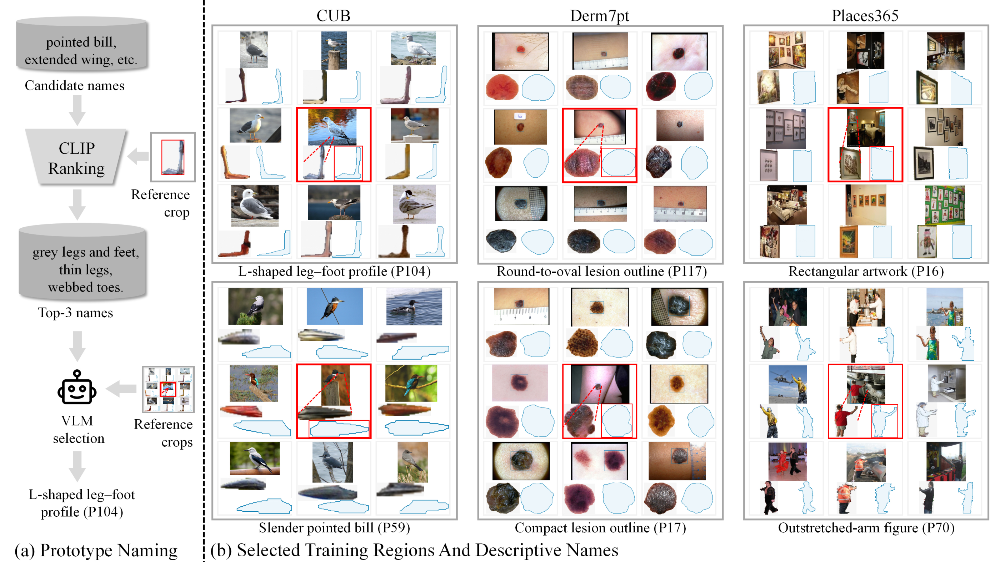
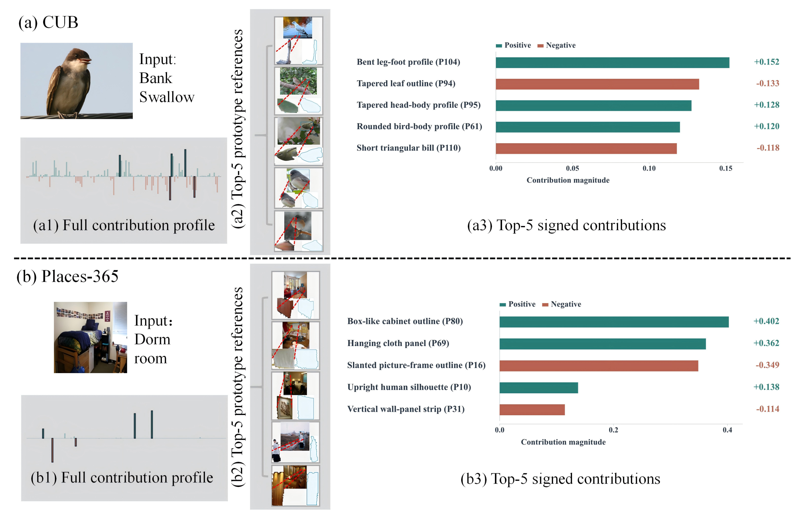

# ARAGPR

**Auditing Residual Attribution with Geometric Prototype References**

Research code for contour-supervised residual coordinates, signed class-margin
attribution, and correspondence diagnostics. The branch takes frozen image
embeddings and base logits. DCBM is the main experimental platform; a separate
runner uses an ordinary frozen CLIP linear classifier.

[中文使用说明](docs/README_zh-CN.md) · [Data preparation](docs/DATA.md) ·
[Experiment protocols](docs/PROTOCOLS.md) · [Entry points](docs/ENTRY_POINTS.md) ·
[Visual guide](docs/VISUAL_GUIDE.md) ·
[Prototype naming templates](docs/prototype_naming/README.md) ·
[GitHub repository](https://github.com/meizhanghao/ARAGPR_main)

## Method

Training-region contours define a prototype bank and image-level response
targets. An affine decoder predicts these coordinates from frozen image
embeddings. A fitted head adds `eta * (W @ u + b)` to the base logits.
For a fixed class contrast, attribution separates the base margin, every signed
coordinate term, and the head bias. Retained training regions and contours are
visual references; they do not localize evidence in a test image.

`decoded` inference uses image embeddings without test masks. `oracle` is the
legacy command-line name for **Direct teacher**, a mask-dependent diagnostic.
`decoded_rel` is the optional validation-correlation-weighted variant.

### Architecture: learn coordinates, then inspect the added scores



During training, region contours define shape prototypes and response targets
that supervise the decoder. At inference, the frozen image embedding supplies
the decoded responses; segmentation masks are no longer needed. The residual
head supplies both additional class scores and a contribution for each
prototype coordinate in a chosen class contrast.

### Prototype clusters: inspect the training regions behind a coordinate



The six grids show two clusters per dataset, with nine selected training regions
in each grid. The central red box marks the actual representative. Original
images, region crops, and contours reveal what a coordinate refers to: for
example, leg-foot profiles, lesion outlines, or rectangular artwork. These
selected members illustrate reference content; they do not measure purity
across the complete cluster. Names are auxiliary reading aids.

### Attribution readout: connect the full profile to Top-5 references



Each row links a complete 128-coordinate profile to the five largest absolute
contributions and their training references, in the same top-to-bottom order.
These unchanged correct predictions use explicit contrasts: Bank Swallow versus
Sayornis, and dorm room versus child's room. Positive and negative values favor
opposite sides of that contrast; their magnitudes depend on both the response
and the fitted head weights. The coordinate plots omit base margins and bias.

See the [visual guide](docs/VISUAL_GUIDE.md) for the residual-interface diagram,
corrected and harmful prediction changes, validation dynamics, and the code
entry points associated with each view. Click any figure to inspect its full
resolution.

## Installation

Use Python 3.10 or 3.11 in a separate environment. Install a PyTorch build
appropriate for your CPU/CUDA environment, then install the core dependencies:

```bash
python -m venv .venv
# Linux/macOS: source .venv/bin/activate
# Windows PowerShell: .venv/Scripts/Activate.ps1
python -m pip install -r requirements.txt
python -m aragpr doctor
```

CLIP image/text encoding, SAM2 segmentation, and baseline runners have
additional dependencies in `requirements-optional.txt`. Existing embeddings and
masks can be reused without installing or running SAM2. SAM2 is installed from
its official repository; a bundled copy of its source and weights is not included.

## Quick check without datasets

```bash
python -X utf8 -m unittest discover -s tests -v
python -m aragpr demo --output outputs/synthetic_demo
```

The demo uses synthetic inputs to export all 128 coordinate contributions and
verify class-margin closure. It runs without datasets or trained checkpoints.

The public NumPy interface also accepts logits from other frozen classifiers:

```python
from aragpr.attribution import class_margin_attribution

audit = class_margin_attribution(base_logits, coordinates, W, b, eta=0.5)
q = audit["coordinate_contributions"]  # images x prototype coordinates
```

The coordinates must use the same training-fitted transformations as the head.
Default contrasts compare each final prediction against its base prediction;
unchanged predictions have a zero contrast. Explicit class indices are supported.

## Prepare inputs

Obtain the datasets from their original providers and prepare the files described
in [docs/DATA.md](docs/DATA.md). Training requires separately prepared images,
region masks, embeddings, and base checkpoints. Five class vocabularies are
supplied under `data/classes/`; the illustrations under `docs/assets/figures/`
provide examples of the method and its outputs.

The default layout is relative to the repository root. To keep data elsewhere,
pass `--project-root /path/to/prepared_data` to `train.py` and
`experiments/controls/run_residual_controls.py`. For relocated cached feature manifests, set
`ARAGPR_DATA_ROOT` to that same directory; recorded feature SHA256 checks remain
active.

## Train the DCBM-platform branch

Run from the repository root. The `geo` CLI value selects the 11-dimensional
`geo11` descriptor. The examples assume prepared inputs and a frozen base model:

```bash
python train.py --dataset CUB_200_2011 --use_shape --shape_input geo \
  --K_shape 128 --shape_mode decoded \
  --freeze_semantic_from semantic_checkpoints/CUB_200_2011_semantic_baseline.pt \
  --pinggu --explain_trace

python train.py --dataset derm7pt --use_shape --shape_input geo \
  --K_shape 128 --shape_mode decoded \
  --freeze_semantic_from semantic_checkpoints/derm7pt_semantic_baseline.pt
```

Use `python train.py --help` for training options, including the
explanation-output directory and sample indices. On PowerShell, put commands on
one line or use PowerShell's continuation character rather than Bash `\`.
Without `--freeze_semantic_from`, the runner fits and saves a semantic base
before training the shape branch. Prepared data can be stored separately using
`--project-root`.

## Residual controls and cached diagnostics

```bash
# Preflight: input checks only; no fitting or output directory creation.
python -m experiments.controls.run_residual_controls --datasets CUB_200_2011 derm7pt \
  --modes geometry affine --seeds 42 --output-root outputs/controls --dry-run

# Fresh paired residual fits; also create the teacher caches used below.
python -m experiments.controls.run_residual_controls --datasets CUB_200_2011 derm7pt \
  --modes geometry random_projection affine shuffled_teacher \
  --seeds 42 43 44 --output-root outputs/controls

python -m experiments.controls.run_decoder_baselines --cache-root outputs/controls \
  --datasets CUB_200_2011 derm7pt --output-root outputs/decoder_baselines

python -m experiments.controls.run_cub_pairing_controls --cache-root outputs/controls \
  --output outputs/cub_pairing
python -m experiments.controls.run_derm7pt_mechanism --cache-root outputs/controls \
  --output outputs/derm_pairing

# Use the model paths produced by those pairing runs.
python -m experiments.diagnostics.run_posthoc_shape_diagnostics --help
python -m experiments.diagnostics.run_teacher_alignment_audit --help
python -m experiments.diagnostics.run_fixed_head_within_class --help
python -m experiments.baselines.run_linear_probe_shape_transfer --help
```

Use a separate output directory for each diagnostic run, and pass the paths to
the prepared inputs, teacher cache, and saved models explicitly.
The ordinary linear-base runner uses a fitted probe and a saved shape decoder;
it does not require a semantic concept bank.

## Reporting and scope

The main classification results use the arithmetic mean of test accuracy over
the final 15 training epochs. Fixed-model diagnostics use validation-selected
checkpoints; pairing studies repeat branch fitting with different seeds.
Reproducing an epoch mean requires the corresponding checkpoint sequence,
whereas a fixed-model diagnostic requires the selected model and its input cache.
See [Experiment protocols](docs/PROTOCOLS.md) for the aggregation rules.

Test targets are used only for the explicitly mask-dependent diagnostics.
Keep the head, scale, standardization, and class contrast fixed for Teacher
replacement; the separately fitted Direct teacher head is a different control.
The retained medical partitions have the limitations discussed in the manuscript;
`experiments/diagnostics/run_derm7pt_case_disjoint.py` provides a separate case-group experiment.

L1 regularization does not guarantee exact zeros. Algebraic closure and visual
references do not, by themselves, establish a purely geometric causal mechanism.

## Auxiliary prototype naming

The [naming guide](docs/prototype_naming/README.md) describes CLIP Top-3 candidate
ranking followed by GPT-4o visual selection, refinement, or abstention. The CLIP
ranking tool is in `tools/naming/`; the GPT-4o prompt and CSV/JSON record
templates are in `docs/prototype_naming/`. Each naming run records its model,
input references, vocabulary, rankings, prompt, and response. The CLIP tool does
not invoke a VLM service. Auxiliary names help readers inspect the references
and have no role in training, prediction, or attribution scores.

## Project layout

```text
train.py                 Main training CLI
aragpr/                  Training implementation, attribution and path helpers
utils/                   Core model classes (stable checkpoint module paths)
experiments/baselines/   Frozen classifiers and base-model training
experiments/controls/    Residual fits, decoder and pairing controls
experiments/diagnostics/ Fixed-model audits, grouping and result summaries
scripts/preprocessing/   Dataset splits, segmentation and feature extraction
tools/references/        Candidate selection and explanation-material exports
tools/audit/             Shape-asset and saved-control integrity checks
tools/naming/            CLIP candidate-ranking pilot
tools/plotting/          Contribution plots and documentation figure exports
data/                    Class vocabularies and region/embedding adapters
tests/                   Dataset-free regression tests
docs/                    Input formats, protocols, visual examples and provenance
docs/prototype_naming/   GPT-4o prompt and empty reproducibility record templates
```

Supporting commands use `python -m package.module` from the repository root.
See the [entry-point map](docs/ENTRY_POINTS.md) for commands and checkpoint
compatibility details.

## Citation and acknowledgements

Citation metadata is provided in [CITATION.cff](CITATION.cff). The DCBM platform
and data utilities adapt the [official DCBM implementation](https://github.com/KathPra/DCBM):

```bibtex
@inproceedings{prasse2025dcbm,
  title = {{DCBM}: Data-Efficient Visual Concept Bottleneck Models},
  author = {Prasse, Katharina and Knab, Patrick and Marton, Sascha and
            Bartelt, Christian and Keuper, Margret},
  booktitle = {Proceedings of the 42nd International Conference on Machine Learning},
  series = {Proceedings of Machine Learning Research},
  volume = {267}, pages = {49752--49782}, year = {2025},
  url = {https://proceedings.mlr.press/v267/prasse25a.html}
}
```

See `LICENSE` and `THIRD_PARTY_NOTICES.md` for attribution and dependency notices.
The repository license does not grant rights to redistribute the datasets or
third-party model weights. Contact: zqmeng@gxu.edu.cn.

This work was supported by the National Natural Science Foundation of China
(Grant Nos. 62266004 and 62666007).

