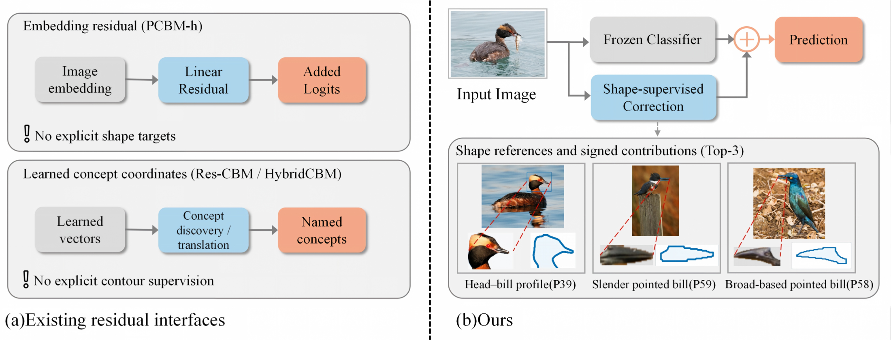
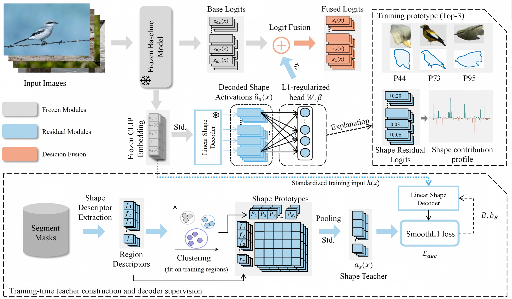
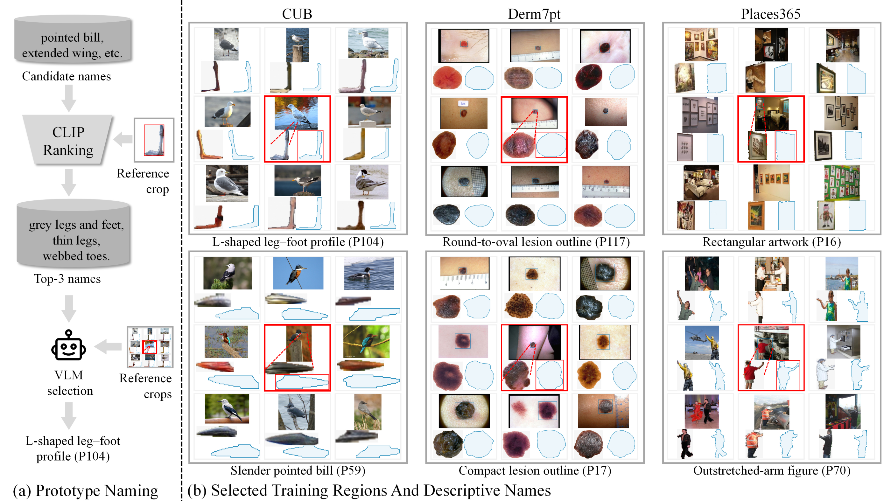
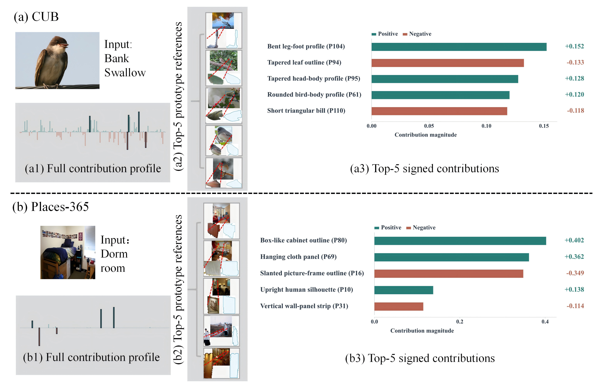
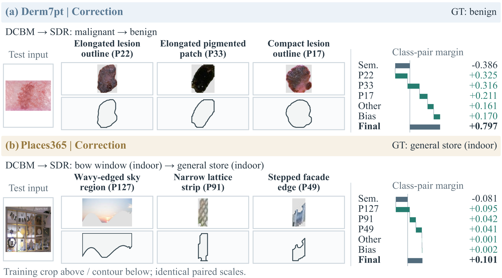
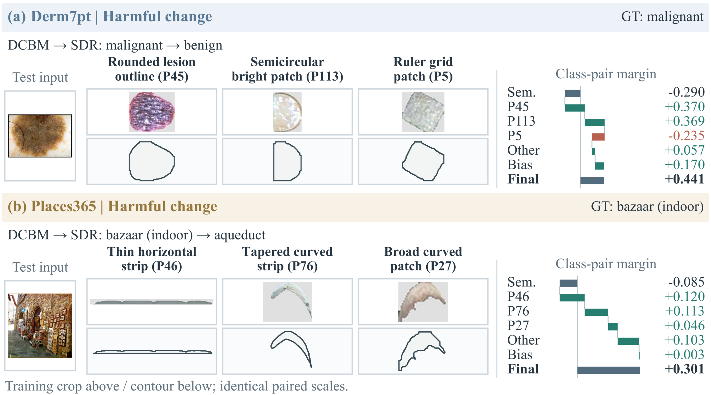
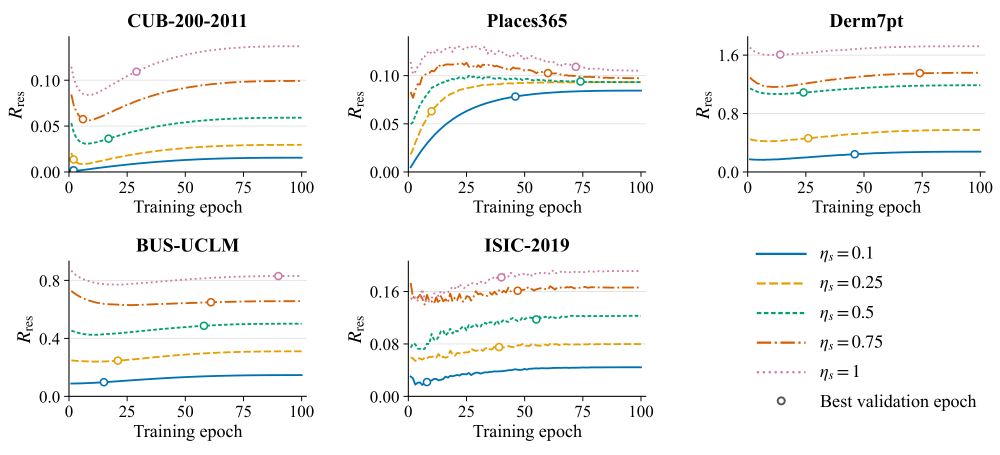

# Visual guide to ARAGPR

[English README](../README.md) · [中文使用说明](README_zh-CN.md) ·
[Experiment protocols](PROTOCOLS.md) · [Entry-point map](ENTRY_POINTS.md)

The figures below are taken from the accompanying manuscript. Together they
show how residual coordinates are constructed, what their training references
contain, and how their signed contributions affect a selected class margin.
Figure numbers follow the manuscript. Click an image for its full resolution.

## Residual interfaces and retained references



**Figure 1.** Panel (a) places concept and residual interfaces in context;
panel (b) introduces contour-supervised coordinates with retained training
regions and contours. The montage illustrates reference content, rather than
a ranked attribution result or an accuracy comparison. Red dashed lines
connect a region to its source image.

The branch receives a frozen image embedding and base logits. DCBM is the main
experimental platform; `run_linear_probe_shape_transfer.py` uses an ordinary
frozen CLIP linear classifier through the same input interface.

## Training and inference have different inputs



**Figure 2.** The lower block constructs shape supervision from training masks:
region descriptors are clustered into prototypes, and pooled prototype
responses provide image-level targets. A decoder learns to predict these
targets from frozen image embeddings. The upper block adds a fitted residual
head to the frozen classifier. Decoded inference uses the image embedding and
does not require a test mask.

The readout is calculated for a specified pair of classes. With transformed
coordinates `u`, residual weights `W`, bias `beta`, and scale `eta`, the fitted
scores and signed terms are:

```text
z = z0 + eta * (W u + beta)
q[k] = eta * (W[target, k] - W[reference, k]) * u[k]
q_bias = eta * (beta[target] - beta[reference])
final_margin = base_margin + sum(q) + q_bias
```

Training-fitted transformations used by the head must also be applied to `u`
when computing attributions. A positive term favors the target over the
reference class; it does not necessarily indicate high raw prototype
similarity. Exact margin accounting is distinct from testing the learned
correspondence to shape targets.

**Code:** `train.py`, `cancha_cub.py`, `utils/residual_controls.py`, and
[`aragpr/attribution.py`](../aragpr/attribution.py).

## Inspect several members of a prototype cluster



**Figure 4.** Panel (b) shows two geo11 clusters from each of CUB, Derm7pt, and
Places365 with `K_shape=128`. Each grid contains nine visually selected regions
from different training images in the same cluster. The central red box marks
the actual representative; the red connector identifies its source region.
The displayed examples cover leg-foot and bill profiles, lesion outlines,
rectangular artwork, and outstretched-arm figures.

Inspect the original image, the extracted region, and its contour together.
Different species or scene categories can contribute similar region geometry:
the source category records provenance rather than defining the coordinate's
meaning. These selected grids illustrate recognizable reference content, not
whole-cluster semantic purity, representative frequency, or localization in a
test image.

Panel (a) depicts auxiliary naming: CLIP ranks candidate phrases and a VLM
selects or refines a name, or abstains. The displayed candidates illustrate the
workflow. Names help readers navigate the references; they never enter training,
prediction, or contribution arithmetic. The supplied
`run_shape_naming_pilot.py` implements the CLIP-ranking step. A VLM call and its
prompt/output records are a separate step, rather than part of that script.

**Code:** shape descriptor and bank construction in `cancha_cub.py`;
reference exports in `run_figure_case_review.py` and
`run_topk_reference_screen.py`; CLIP candidate ranking in
`run_shape_naming_pilot.py`. These require locally prepared assets as described
in [DATA.md](DATA.md).

## Link all coordinate terms to selected visual references



**Figure 5.** The two examples are unchanged correct predictions: Bank Swallow
versus Sayornis, and dorm room versus child's room. Each contrast uses the
predicted class and the frozen classifier's runner-up. This explicit contrast
is essential: final prediction versus base prediction would be zero when the
prediction has not changed.

In each row, the first panel contains all 128 signed coordinate terms, with the
Top-5 highlighted. The middle references and right-hand bars correspond from
top to bottom, ordered by descending absolute contribution. Horizontal bar
lengths show magnitude; color and signed values retain direction. Base margins
and residual biases are excluded from these coordinate-only plots.

The CUB example includes both bird-related and leaf-related coordinates; the
dorm-room example includes furniture, cloth, architectural regions, and a human
silhouette. Retaining all terms makes such content visible rather than
selecting only intuitively favorable references. A readable training reference
does not establish class-specific or causal test-image evidence.

For an unchanged-prediction subset, the public interface accepts the explicit
contrast used for this kind of plot:

```python
import numpy as np
from aragpr.attribution import class_margin_attribution

# Inputs are arrays; coordinates already use the head's fitted transformation.
final_logits = base_logits + eta * (coordinates @ W.T + b)
unchanged = final_logits.argmax(1) == base_logits.argmax(1)
base_order = np.argsort(base_logits[unchanged], axis=1)

audit = class_margin_attribution(
    base_logits[unchanged], coordinates[unchanged], W, b, eta=eta,
    target_classes=base_order[:, -1],
    reference_classes=base_order[:, -2],
)
q = audit["coordinate_contributions"]
top5 = np.argsort(-np.abs(q), axis=1)[:, :5]
```

Select correct predictions using ground-truth labels if reproducing the
figure's correct-prediction cohort. The default interface instead compares
final and base predictions, as used in the changed-prediction waterfalls below.

**Code:** `run_cub_figure2_candidates.py`, `run_figure_case_review.py`,
[`aragpr/attribution.py`](../aragpr/attribution.py), and
[`tools/plot_contributions.py`](../tools/plot_contributions.py).
The plotting tool reads a contribution CSV: `--mode profile` draws all 128
coordinates; `--mode bars` draws the Top-5 by default. Output SVGs are written
alongside that plotting script. Font and weight settings are grouped at its top.

## Inspect corrected and harmful changes with the same decomposition



**Figure 6.** Both predictions change from incorrect to correct. The waterfalls
show the base margin (`Sem`), the three largest absolute coordinate terms,
`Other` (all remaining coordinate terms), the residual `Bias`, and `Final`.
The class contrast is final prediction versus base prediction. Ground truth
determines whether the change is a correction.



**Figure 7.** The same readout exposes changes from correct to incorrect. A
positive term now favors the erroneous final class over the base prediction;
it does not become beneficial merely because its reference is recognizable.
The two figures use matching within-dataset margin scales. Displayed values are
rounded, so closure should be checked with the unrounded export.

These selected cases illustrate how to inspect a change, rather than how often
it occurs. Aggregate correction/harm statistics and fixed-head target
replacement answer separate questions. The retained medical partitions have
the case-overlap limitations described in the manuscript; these examples are
exploratory readouts.

**Code:** `train.py --pinggu --explain_trace` for explanation traces;
`utils/sdr_cbm_visualize.py` for the saved-run readout;
`run_teacher_alignment_audit.py` for decision-level correspondence diagnostics.

## Follow validation behavior across residual scales



**Figure 3.** Each dataset panel shows the decoded branch with geo11 and
`K_shape=128` across residual scales. A curve uses one scale, and its marker
indicates the best validation epoch. Vertical scales differ between panels.
The figure helps inspect fitting and scale selection; it is not a test-set
ranking or an explanation-stability measurement.

**Code:** `train.py` / `cancha_cub.py` with the scale and training options shown
by `--help`. The exact manuscript curves require their original training logs;
those run artifacts are not included in this source release.

## Figure provenance and re-export

All seven images preserve the complete manuscript figure pages, including
their original labels and numerical values. Source and image SHA256 hashes
are recorded in [`assets/figures/manifest.json`](assets/figures/manifest.json).
The images are documentation illustrations rather than a dataset distribution;
see [THIRD_PARTY_NOTICES.md](../THIRD_PARTY_NOTICES.md).

To re-export from your local standalone manuscript figure PDFs:

```bash
python -m pip install -r requirements-docs.txt
python tools/export_paper_figures.py --source-dir /path/to/manuscript
```

The optional documentation dependencies are separate from the core training
dependencies. The script checks that the source PDFs remain unchanged and
updates `docs/assets/figures/manifest.json` with the new image hashes.
